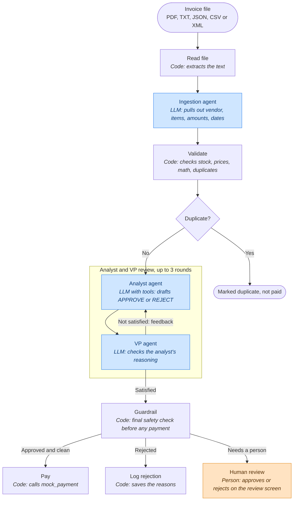

# Acme invoice pipeline: multi-agent invoice processing (Galatiq case)

## What it does

The system takes an invoice in whatever shape it arrives (PDF, text, JSON, CSV, XML; typos, odd labels, missing fields), reads it with an AI agent, checks it against Acme's inventory and price list, has two AI agents (an analyst and a VP) argue the approve/reject decision, and then either pays it through the mock payment API or logs the rejection with written reasoning. Hard rules (stock, unknown items, bad data, double-billing) are enforced by code, not by the AI, so no argument from an agent or text on an invoice can get a bad invoice paid. Every outcome records who decided (agents, guardrail, human or system) and why. When the agents can't settle a case, or approve an invoice whose prices differ from Acme's records, it waits for a person on a review screen built for a PE analyst or VP.

### Business impact

Acme loses about **$2M/year** to manual invoice handling: a **30% error rate** and **5-day delays**.

- **Delay, 5 days → minutes.** Extraction, inventory check, approval reasoning and payment run in one pass, around a minute per invoice. On the 20 sample files, **every one was settled with written reasons in about 5 minutes; none had to wait for a person** (6 paid, 11 rejected, 3 duplicates).
- **Errors are caught by rules, not by attention.** Over-stock orders, unknown or zero-stock items, negative quantities, missing vendors, overbilled totals and reused invoice numbers are rejected by code every time: **9 of the 20 samples are blocked this way**, **2 more are rejected by the agents** for an unexplained price or currency deviation, and **3 are recognized as the same invoice sent twice**, so they are never paid twice.
- **Humans stay where judgment and money meet.** A person decides when the two agents disagree after three rounds, and whenever an approved invoice's prices or totals differ from Acme's reference (a rush fee, a discount, a foreign currency). The reviewer sees the original document with the uncertain spots highlighted, the agents' argument, and a plain verdict, not logs.
- **Every decision is auditable.** Reasoning, flags, the full analyst ⇄ VP exchange and the deciding party are stored per invoice.

## Quick start

Requires Python 3.11+ (or [uv](https://docs.astral.sh/uv/)) and an xAI API key.

### See it in the browser (one command)

```bash
./start
```

That's it. The script:
1. creates a Python environment in `.venv` and installs everything (first run only, about a minute),
2. asks for your xAI API key if `.env` doesn't have one yet (saved to `.env`, which git ignores),
3. starts the review screen and opens **http://127.0.0.1:8000** in your browser. Press **Ctrl+C** to stop it.

Once it's open, click **Process all sample invoices** to watch all 20 samples go through live (about 5 minutes, 5 at a time), or drop any file from `data/invoices/` into the upload area to follow a single invoice (about 20 seconds). Then open any invoice in the queue to see the original document, the flags, the analyst and VP's back-and-forth, and the decision.

| Variation | What it does |
|---|---|
| `./start --reset` | Same, but wipes previous results first for a clean demo |
| `PORT=8010 ./start` | Use a different port if 8000 is taken |
| `NO_BROWSER=1 ./start` | Don't open a browser tab automatically |

### Command line

The `./start` script sets up the environment; after that (or after a manual setup), activate it and use `main.py` directly:

```bash
source .venv/bin/activate        # manual setup instead of ./start: uv venv && uv pip install -e ".[dev]"
cp .env.example .env             # only if ./start hasn't created it; put your key in XAI_API_KEY=...
```

| Command | What it does |
|---|---|
| `python main.py --invoice_path=data/invoices/invoice_1001.txt` | Process one invoice; prints invoice, vendor, amount, outcome, why, decided by |
| `python main.py --invoice_dir=data/invoices` | Process every file in a folder, 5 at a time (`BATCH_WORKERS`); prints a summary table in filename order |
| `python main.py --reset` | Wipe run history, results and checkpoints (inventory is re-seeded) for a clean demo; combine with the other flags |
| `python main.py --serve` | Start the review screen at **http://127.0.0.1:8000** |

The review screen lets you upload invoices or **process all samples** with one click, watch each invoice move through the stages live, work the **review queue** (needs-review items on top, dollar exposure summarized), open an invoice to see the original document beside the extracted fields, and **approve or reject** with a note. The CLI never blocks on a human: paused invoices end the run as `NEEDS_HUMAN_REVIEW` and are resumed from the screen.

Runtime files live in `var/` (gitignored): `var/app.db` (inventory + run history), `var/checkpoints.db` (paused runs), `var/logs/run.jsonl` (one structured JSON line per pipeline stage). The model is set by `XAI_MODEL` (default `grok-4-1-fast-non-reasoning`); `BATCH_WORKERS` (default 5, `1` = one at a time) sets how many invoices a batch runs at once.

**Batches.** A folder run (and the screen's "process all samples") works on 5 invoices at once, each worker on its own database connections and checkpointer; the per-invoice pipeline is unchanged. The duplicate check is the only step that looks across invoices, so it is atomic: the lookup and the recording of the invoice's number and fingerprint happen under one lock, and of two copies exactly one is the original (which copy that is can differ between runs). Any run that ended ERROR because Grok timed out, dropped the connection or returned a 5xx is retried once, one at a time, after the batch; the CLI says how many were.

## Architecture

Blue steps call Grok (AI), orange is a person, everything else is plain Python. The LangGraph graph decides what runs next; no AI ever chooses the next step or triggers a payment.



**What the guardrail does.** It is a few lines of plain code that sit between the agents and the money, so no AI answer on its own can get a bad invoice paid. When the agents approve, it checks three things in order:
1. **Any hard-rule flag** (for example an item not in inventory, or more than is in stock) turns the approval into **Rejected**.
2. **Any price, total or currency that differs from Acme's records**, or an amount that isn't printed on the invoice, sends it to **Needs a person** instead of paying.
3. **Only an approval with neither problem is Paid.**

Agent rejections go straight to **Rejected**, and if the analyst and VP still disagree after 3 rounds, the invoice goes to **Needs a person**.

### How an invoice moves through the app

1. **Read.** The file's text is pulled out (pdfplumber for PDFs, plain text for everything else) and the file gets a fingerprint so the same file is never paid twice.
2. **Ingest.** The ingestion agent turns the messy text into a structured invoice. Code then cleans the values: dates become real dates, money becomes exact decimals, "Widget A" becomes the inventory item WidgetA.
3. **Validate.** The rulebook (below) checks the invoice against Acme's inventory, price list and invoice history and produces flags. If this exact invoice was already processed, it stops here as a duplicate.
4. **Analyst and VP.** The analyst investigates with its tools and recommends APPROVE or REJECT with evidence. The VP reviews that reasoning and either accepts it or sends it back with specific feedback. They get up to 3 rounds to agree.
5. **Guardrail.** If the agents approve, code double-checks: any hard-rule flag forces a rejection, and any price, total or currency difference goes to a person instead of being paid.
6. **Decide.** The invoice is paid through the mock payment API, rejected with written reasons, or held for a person on the review screen. Every outcome records who decided (agents, guardrail, human or system) and why.

### The agents

**Ingestion agent** (`invoice_agent/agents/ingestion/`)
- **Job:** read one invoice's raw text, in any layout, and return a structured invoice: invoice number, vendor, dates, currency, line items, subtotal, tax, shipping, total.
- **How it works:** one Grok call with a strict output schema. For every field it returns the value, the exact text it read it from, and a confidence (high, medium or low). It copies every amount exactly as printed; doing the math is code's job, so it can't quietly "fix" what Acme pays.
- **Self-correction:** if the answer doesn't fit the schema or has no line items, the errors are sent back and it tries again (up to 2 retries). Low-confidence fields are highlighted on the review screen.

**Analyst agent** (`invoice_agent/agents/analyst/`)
- **Job:** act as the accounts-payable analyst. Given the invoice, its validation flags and the uncertain fields, draft a recommendation: APPROVE or REJECT, with reasoning and evidence.
- **How it works:** a Grok agent that calls tools to gather facts instead of assuming them (stock, reference prices, vendor history, exact arithmetic). It must explain every flag that needs scrutiny; anything unexplained means REJECT. Invoices over $10,000 also need a 5-point checklist: vendor history, prices, stock, arithmetic and payment terms.
- **When sent back:** it gets the VP's feedback and must address every point in its next draft.

**VP agent** (`invoice_agent/agents/vp/`)
- **Job:** act as the VP of Finance. Judge whether the analyst's reasoning is complete, supported by evidence and consistent with the approval policy.
- **How it works:** a Grok agent that can spot-check stock and prices but deliberately has no invoice-history tool: if evidence is missing, it sends the work back rather than doing the analyst's job. It either accepts (with a final APPROVE or REJECT) or sends it back with specific feedback.
- **Limits enforced in code:** it can't accept an over-$10K recommendation with a missing checklist item, and if the two agents still disagree after 3 rounds, the invoice goes to a person.

Both approval agents read the vendor's text inside a clearly marked "untrusted data" block and are told never to follow instructions found there, and every rule that matters is a code gate they cannot argue past.

### Agent tools

| Tool | Used by | What it does |
|---|---|---|
| `get_inventory(item)` | Analyst, VP | Looks up an item's stock on hand and Acme's reference unit price. |
| `get_invoice_history(vendor, invoice_number)` | Analyst | Lists earlier invoices from the same vendor or with the same number, to spot duplicates and patterns. |
| `get_approval_policy()` | Analyst, VP | Returns the approval rules: what each flag means for the decision, plus the over-$10K checklist. |
| `calculate(expression)` | Analyst | Does exact arithmetic (for example `15*250 + 5*240`) so totals are checked, not guessed. Uses a safe parser, never `eval`. |

### Agentic vs deterministic

AI is used only where judgment is needed: reading messy documents, and weighing evidence into a decision with reasons. Everything that must be exact or must never be talked out of is plain Python: the order of steps, arithmetic, stock and price checks, duplicate detection and the payment gate. The analyst and VP loop is a real critique loop: it ends when the VP is satisfied with the *reasoning*, so a well-argued REJECT counts as a success.

### Folder map

| Path | Contents |
|---|---|
| `main.py` | CLI entry point (`--invoice_path`, `--invoice_dir`, `--reset`, `--serve`) |
| `invoice_agent/graph.py` | The LangGraph pipeline: stages, routing, guardrail, human-review interrupt, pay / log |
| `invoice_agent/runner.py` | Runs files through the graph (batches in parallel, timeout retry), re-run policy, saving results, resuming reviews |
| `invoice_agent/models.py` | Shared Pydantic models and graph state |
| `invoice_agent/agents/` | Everything that calls Grok: `ingestion/`, `analyst/`, `vp/` (prompt + agent each), `approval/` (loop, policy, tools, briefing), `llm.py` |
| `invoice_agent/utils/` | Plain-code stages: `reader.py`, `normalize.py`, `arithmetic.py`, `validation/` (rulebook, duplicates), `guardrail.py`, `payments.py` |
| `invoice_agent/infra/` | `config.py` (settings and business knobs), `db.py` (SQLite inventory + run history), `logging_setup.py` |
| `invoice_agent/web/` | Review screen: `app.py` (routes, upload, background runs), `security.py`, `highlight.py`, `templates/`, `static/` |
| `tests/` | Mirrors the package; offline tests use scripted fake agents |

## The rulebook

Validation produces flags in three severities. The agents see all of them; code enforces the first column regardless of what the agents conclude.

| Severity | What it means | Checks |
|---|---|---|
| **must_reject** | Never paid on the agents' say-so. If the agents approve anyway, the guardrail forces REJECT. Only a human can override, with a written justification. | quantity exceeds stock (summed across repeated lines of the same item) · item not in inventory · zero-stock / suspicious item · quantity ≤ 0 · negative total · missing vendor or total · missing quantity · no line items · stated total higher than line items + tax + shipping · line total higher than qty × price · invoice number already used with different contents (possible double-billing) |
| **needs_scrutiny** | The analyst must explain each one in writing; unexplained means REJECT. A price, total or currency deviation (or an amount not printed on the invoice) also sends an agent APPROVE to a person before payment. | unit price ≠ Acme reference price (any amount, no tolerance) · totals don't reconcile · total over $10K (triggers a 5-point checklist the VP cannot skip) · due date missing or on/before invoice date · non-USD currency · missing unit price · an extracted amount that isn't printed anywhere on the invoice · extraction uncertainty |
| **info** | Context for the agents; decides nothing on its own. | urgency / wire-transfer pressure language · "formerly" vendor rename |

Reference stock and prices (seed data, extended with a `unit_price` column): WidgetA 15 @ $250, WidgetB 10 @ $500, GadgetX 5 @ $750, FakeItem 0.

## Results on the sample invoices

Live run of `BATCH_WORKERS=5 python main.py --reset --invoice_dir=data/invoices` (grok-4-1-fast-non-reasoning, 2026-11-17): **6 PAID, 9 blocked by hard rules, 2 rejected by the agents on judgment, 3 DUPLICATE, 0 waiting for a person, 0 ERROR.**

| File | Vendor | Amount | Outcome | Why |
|---|---|---|---|---|
| invoice_1001.txt | Widgets Inc. | $5,000.00 | PAID | Clean: stock, prices and math all check out |
| invoice_1002.txt | Gadgets Co. | $15,000.00 | REJECTED | 20 GadgetX ordered, 5 in stock (rule) |
| invoice_1003.txt | Fraudster LLC | $100,000.00 | REJECTED | FakeItem: zero-stock / suspicious item, exceeds stock (rule) |
| invoice_1004.json | Precision Parts Ltd. | $1,890.00 | PAID | Clean original of INV-1004 |
| invoice_1004_revised.json | Precision Parts Ltd. | $5,940.00 | REJECTED | INV-1004 reused with different contents: possible double-billing (rule) |
| invoice_1005.json | Global Supply Chain Partners | $15,225.00 | REJECTED | 8 GadgetX ordered, 5 in stock (rule) |
| invoice_1006.csv | Acme Industrial Supplies | $2,750.00 | PAID | Clean |
| invoice_1007.csv | MegaWidgets Corp | $15,525.00 | REJECTED | WidgetA and WidgetB exceed stock (rule); printed total kept as printed, its under-billing flagged |
| invoice_1008.txt | NoProd Industries | $9,900.00 | REJECTED | SuperGizmo / MegaSprocket not in inventory (rule, enforced by the guardrail) |
| invoice_1009.json | (missing) | −$250.00 | REJECTED | Missing vendor, negative quantity and total (rule) |
| invoice_1010.txt | Consolidated Materials Group | $7,185.00 | REJECTED | WidgetA at $300 vs $250 reference, unexplained rush fee (agents) |
| invoice_1011.pdf | Summit Manufacturing Co. | $3,000.00 | PAID | Clean |
| invoice_1011.txt | Summit Manufacturing Co. | $3,000.00 | DUPLICATE | Same invoice as the PDF |
| invoice_1012.pdf | QuickShip Distributers | $9,975.00 | PAID | Clean (vendor-rename note is information only) |
| invoice_1012.txt | QuickShip Distributers | $9,975.00 | DUPLICATE | Same invoice as the PDF |
| invoice_1013.json | Atlas Industrial Supply | $22,562.80 | REJECTED | 22 WidgetA, 18 WidgetB, 9 GadgetX exceed stock, and the total is $50 more than its lines + tax (rule) |
| invoice_1013.pdf | Atlas Industrial Supply | $22,562.80 | DUPLICATE | Same invoice as the JSON |
| invoice_1014.xml | TechParts International | $4,125.00 | REJECTED | EUR invoice at non-reference prices; can't be verified against USD reference (agents) |
| invoice_1015.csv | Reliable Components Inc. | $6,500.00 | PAID | Clean |
| invoice_1016.json | Widgets Inc. | $3,233.00 | REJECTED | WidgetC not in inventory (rule) |

**Wall clock for the 20 files:** about 18 minutes one at a time (Task 12 run, including a 10-minute Grok slowdown; ~7 minutes at the normal ~20 s per invoice) vs **about 5 minutes with 5 workers** on this run, with no Grok timeouts. Which copy of a duplicate pair is the original can differ between runs, and agent judgment (PAID vs needs review vs rejected on a price deviation) can vary too; the rule-based outcomes don't. In this run the agents rejected both price/currency deviations outright, so nothing waited for a person; had they approved either one, the guardrail would have sent it to the review screen instead of paying.

## Safety and design decisions

- **Payment has exactly two doors:** both agents approve *and* there is no must_reject flag *and* no price/total/currency deviation, or a human approves on the review screen.
- **Never pay twice:** the same invoice in two formats is caught by a content fingerprint and marked DUPLICATE; a reused number with different contents is rejected; re-running a file that was already paid or is awaiting review returns the stored result; a crash after payment is recovered from the checkpoint instead of paying again.
- **Prompt-injection defenses:** vendor text is fenced as untrusted data in the agents' briefing, the policy lives in the system prompt, and every rule that matters is a code gate the agents cannot argue past.
- **Fail closed:** missing quantities, prices, vendors or totals, totals too large to verify, and unreadable files all end in REJECT, review or ERROR, never in payment. If the analyst/VP call fails (e.g. a Grok timeout) on an invoice that already broke a hard rule, it is still REJECTED by the guardrail, with a note that the agents' write-up is missing.
- **Money is `Decimal`, never float:** amounts reconcile to the cent.
- **Printed amounts are copied, never fixed:** the ingestion agent is told to copy every amount exactly as printed, its arithmetic mismatches are not sent back as "fix this", and code checks that every extracted amount actually appears in the source text, so an AI can't quietly change what Acme pays (it once rewrote 1013's total to make the math work).
- **Local review screen is guarded:** state-changing requests must come from the screen itself (CSRF origin check), the server only answers to localhost (trusted-host check against DNS rebinding), each web request opens its own SQLite connection (WAL, 5 s busy timeout), and uploads are size-limited with sanitized file names.
- **Human decisions are final and recorded:** a human approve or reject is never overturned by a re-run, and approving over a hard rule requires a justification that is logged.
- **Rules are data, not magic:** inventory is static reference data, so outcomes don't depend on processing order (only which copy of a duplicate pair counts as the original can vary); business knobs (3 rounds, $10K threshold, 2 extraction retries) are in `invoice_agent/infra/config.py`.

## Testing

```bash
.venv/bin/pytest                      # offline suite: 235 tests, ~7 s, no network (scripted fake agents)
.venv/bin/pytest -m live -v -s        # live tests against real Grok (reads XAI_API_KEY from .env)
timeout 900 .venv/bin/pytest -m live tests/test_expected_outcomes.py -v -s    # all 20 samples end to end, 5 at a time
```

The offline suite covers reading, normalization, every rulebook check, the guardrail, the approval loop routing, the graph (pause/resume, duplicates, error paths), the runner's re-run policy, parallel batches (same results as one-at-a-time, exactly one original per duplicate pair even when both copies are validated at the same moment, whole log lines, the end-of-batch timeout retry), the CLI and the review screen. The live suite has 18 tests: one extraction test and the end-to-end sample test, which runs the whole folder into a temporary database (it never touches your `var/`) and asserts every outcome that code guarantees: rejections, exactly one DUPLICATE / one reused-number rejection per pair, and that price-deviating invoices are never auto-paid. Outcomes that are genuine LLM judgment (PAID vs needs review for clean invoices) are printed, not asserted.

## Assumptions and limitations

- **Local prototype:** single machine, SQLite, no cloud deployment; payment is the README's mock function.
- **One processor per file at a time:** don't run CLI batches while the server is processing the same files.
- **No reviewer login:** the review screen is localhost-only and has no authentication or per-user roles; anyone at the machine can approve.
- **Currency:** EUR (and any non-USD) amounts are not converted; they are flagged and compared as-is, so such invoices go to a person.
- **Prices are ground truth:** any deviation from Acme's reference price is scrutinized, even a legitimate discount. The cost is an extra human click on those invoices.
- **PDFs need a text layer:** scanned image PDFs are reported, not OCR'd.
- **Model choice:** `grok-4-1-fast-non-reasoning` at temperature 0. `grok-3` timed out and returned HTTP 500s on the analyst's tool-calling loop in testing; this model ran the whole pipeline reliably and quickly. Override with `XAI_MODEL`.
- **LLM judgment varies:** a clean invoice may be PAID on one run and sent to review on another; the hard outcomes (rejections, duplicates, no auto-pay on price deviations) are enforced by code and do not vary.

---

## Case brief

The original case brief, kept as provided.

### Background

Acme Corp is a PE-backed manufacturing firm losing **$2M/year** on manual invoice processing. Invoices arrive via email as PDFs in messy formats with frequent errors. Staff manually extract data, validate against a legacy inventory database (inconsistent), obtain VP approval (via email chains), and process payment (via a banking API).

**Current pain points:**
- 30% error rate
- 5-day processing delays
- Frustrated stakeholders

### Objective

Build a **multi-agent system** that automates the end-to-end invoice processing workflow. The system must run as a working prototype, not just designs or slides.

### Workflow

The system should handle four stages:

1. **Ingestion**: Extract structured data from invoice documents (PDFs, text files). Fields include: Vendor, Amount, Items (with quantities), and Due Date. Expect unstructured text, typos, missing data, and potentially fraudulent entries.

2. **Validation**: Verify extracted data against a mock inventory database (SQLite). Flag mismatches such as quantity exceeding available stock or items not found in inventory.

3. **Approval**: Simulate VP-level review with rule-based decision-making (e.g., invoices over $10K require additional scrutiny). The agent should reason through approval/rejection with a reflection or critique loop.

4. **Payment**: If approved, call a mock payment function. If rejected, log the rejection with reasoning.

### Technical Requirements

- **LLM Integration**: Use xAI's Grok as the core reasoning engine (via the xAI API at https://grok.x.ai). Other models are acceptable if you don't have an API key.
- **Multi-Agent Orchestration**: Use a framework such as LangGraph, CrewAI, AutoGen, or a custom solution.
- **Agent Capabilities**: Function calling / tool use, structured outputs, and self-correction loops.
- **Runtime**: Assume no internet for external APIs: simulate everything locally.
- **Tech Stack**: Python (preferred), with libraries like `langchain`, `crewai`, `autogen`, `pdfplumber`, `PyMuPDF`, etc. Run locally, no cloud deployment.

### Provided Resources

#### Mock Invoice Data

Sample invoices are provided in the `data/invoices/` directory in various formats (PDF, CSV, JSON, TXT). Use these as inputs for testing. The data intentionally includes a mix of clean entries and problematic ones: identifying and handling issues is part of the challenge.

#### Mock Inventory Database (Required Setup)

Before running the system, you **must** create a local SQLite database that the validation agent will check invoices against. The sample invoices in `data/invoices/` reference specific items and quantities: your database needs to contain matching inventory records so the validation stage can flag mismatches, out-of-stock items, and unknown products.

Below is a starter schema and seed data that covers the core items referenced across the provided invoices:

```python
import sqlite3

conn = sqlite3.connect('inventory.db')  # Persist to file so all agents can access it
cursor = conn.cursor()

cursor.execute('CREATE TABLE IF NOT EXISTS inventory (item TEXT PRIMARY KEY, stock INTEGER)')
cursor.execute("""
    INSERT INTO inventory VALUES
    ('WidgetA', 15),
    ('WidgetB', 10),
    ('GadgetX', 5),
    ('FakeItem', 0)
""")
conn.commit()
```

**Why this matters:** The sample invoices are designed to test your validation logic against this database. For example:

| Scenario | Invoice | What should happen |
|---|---|---|
| Normal order within stock | INV-1001, INV-1004, INV-1006 | Items found, quantities valid: passes validation |
| Quantity exceeds stock | INV-1002 (requests 20× GadgetX, only 5 in stock) | Flagged as stock mismatch |
| Fraudulent / zero-stock item | INV-1003 (references FakeItem, 0 stock) | Flagged as out of stock or suspicious |
| Item not in database at all | INV-1008 (SuperGizmo, MegaSprocket), INV-1016 (WidgetC) | Flagged as unknown item |
| Invalid data | INV-1009 (negative quantity) | Flagged as data integrity issue |

You may extend the seed data with additional items or columns (e.g., unit price, category) to support richer validation: the above is the minimum needed to exercise the provided test invoices. If you want your system to also validate pricing or vendor information, consider adding tables for those as well.

#### Mock Payment API

```python
def mock_payment(vendor, amount):
    print(f"Paid {amount} to {vendor}")
    return {"status": "success"}
```

#### Grok API Setup

```python
from xai import Grok

client = Grok(api_key="your_key")
response = client.chat.completions.create(
    model="grok-3",
    messages=[{"role": "user", "content": "Reason about this..."}]
)
```

### Running the System

The system should be executable from the command line:

```bash
python main.py --invoice_path=data/invoices/invoice1.txt
```

Output should include structured logs and results.

### Evaluation Criteria

- **Functionality**: Does the system work end-to-end?
- **Code Quality**: Clean, testable, well-structured code with error handling and observability
- **Agentic Sophistication**: LLM integration, multi-agent flow, tool use, self-correction loops
- **Shipping Mindset**: Valuable MVP delivered under ambiguity; scope ruthlessly cut where needed
- **Presentation**: Clear translation of technical decisions to business impact
- **Above/Beyond** - Have you made it your own? Implemented additional features that make the solution feel great? Expanded assumptions? Added to test cases?
- **UI/UX** - Users will understand and enjoy using this system.

### Submission

Submit your solution as a link to a public GitHub repository: GitHub only (github.com).
