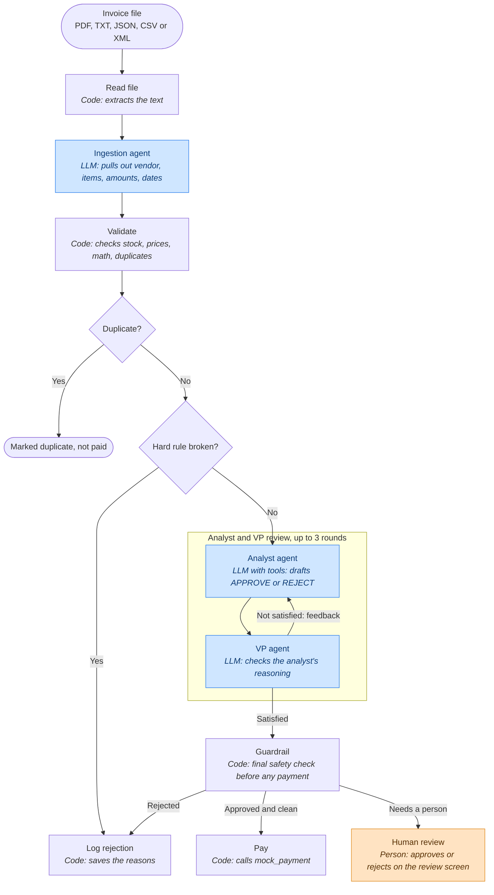

# Acme invoice pipeline: multi-agent invoice processing (Galatiq case)

A LangGraph pipeline that takes an invoice in any shape (PDF, text, JSON, CSV, XML; typos, odd labels, missing fields) and pays it or rejects it with written reasons. Three Grok agents do the judgment work: an ingestion agent reads the document, then an analyst and a VP debate approve or reject in a critique loop of up to 3 rounds. Hard rules (stock, unknown items, bad data, overbilling, double-billing) are enforced by a code guardrail, so no agent answer or text on an invoice can get a bad invoice paid. When the agents can't agree, or prices, totals or currency differ from Acme's records, the invoice waits for a person on a local review screen.

## Business impact

Acme loses about **$2M/year** to manual invoice handling: a **30% error rate** and **5-day delays**.

- **5 days becomes minutes.** Each invoice runs end to end in about 20 seconds; the 20 sample files were all settled, with written reasons, in about 5 minutes.
- **Errors are caught by code, not attention.** Over-stock, unknown items, negative quantities, missing vendors and overbilled totals are rejected every time (9 of the 20 samples), and the 3 files sent twice are never paid twice.
- **People decide only where judgment and money meet:** agent deadlocks and any price, total or currency difference from Acme's records.
- **Every decision is auditable:** reasoning, flags, the full analyst and VP exchange, and who decided (agents, guardrail, human or system) are stored per invoice.

## Quick start

Requires Python 3.11+ (or [uv](https://docs.astral.sh/uv/)) and an xAI API key.

```bash
./start
```

1. Creates `.venv` and installs dependencies (first run only, about a minute).
2. Asks for your xAI API key if `.env` has none and saves it there (git ignores `.env`).
3. Starts the review screen with empty history and opens **http://127.0.0.1:8000**. **Ctrl+C** stops it.

Options: `./start --keep` keeps earlier history, `PORT=8010 ./start` changes the port, `NO_BROWSER=1 ./start` skips opening a tab.

### Try it

1. Press **Process an invoice**, then **Choose a file**, pick `data/invoices/invoice_1010.txt` and press **Process this invoice**.
2. The invoice's page fills in live and stops at **Waiting for you**: WidgetA is billed at $300.00 vs Acme's $250.00 (a rush fee). Use **Show in invoice** to check the line, then approve or reject.
3. Process `data/invoices/invoice_1016.json`: WidgetC isn't in inventory, so a hard rule rejects it in seconds without the agents. **Run all 20 sample invoices** on the dashboard processes the whole set.

### Command line

After `./start` (or `uv venv && uv pip install -e ".[dev]"` and a `.env` copied from `.env.example`), run `source .venv/bin/activate`, then:

| Command | What it does |
|---|---|
| `python main.py --invoice_path=data/invoices/invoice_1001.txt` | Process one invoice; prints vendor, amount, outcome, why and who decided |
| `python main.py --invoice_dir=data/invoices` | Process a folder, 5 at a time, and print a summary table |
| `python main.py --reset` | Wipe history, results and checkpoints (inventory is re-seeded); combines with the other flags |
| `python main.py --serve` | Start the review screen at **http://127.0.0.1:8000** |

Environment: `XAI_MODEL` (default `grok-4-1-fast-non-reasoning`) and `BATCH_WORKERS` (default 5; `1` runs one at a time).

## Architecture

Blue steps call Grok (AI), orange is a person, everything else is plain Python. The LangGraph graph decides what runs next; no AI ever chooses the next step or triggers a payment.



### How an invoice moves through the app

1. **Read:** pull the text out of the file (pdfplumber for PDFs) and fingerprint it so the same invoice is never paid twice.
2. **Ingest:** the ingestion agent returns a structured invoice; code turns dates into dates, money into exact decimals and "Widget A" into WidgetA.
3. **Validate:** code checks inventory, prices, arithmetic and history; a duplicate stops here, and a hard-rule break goes straight to a logged rejection.
4. **Analyst and VP:** the analyst recommends APPROVE or REJECT with evidence; the VP accepts it or sends it back, for up to 3 rounds.
5. **Guardrail:** any hard-rule flag forces REJECT; a price, total or currency difference goes to a person whatever the agents said.
6. **Decide:** pay through `mock_payment`, log the rejection, or wait for a person; every outcome records who decided and why.

### The agents

**Ingestion agent** (`invoice_agent/agents/ingestion/`)
- **Job:** turn one invoice's raw text, in any layout, into a structured invoice (number, vendor, dates, currency, line items, totals).
- **How:** one Grok call with a strict schema; every field comes with the text it was read from and a confidence. Amounts are copied as printed, never fixed. Schema errors or missing line items are sent back for up to 2 retries.

**Analyst agent** (`invoice_agent/agents/analyst/`)
- **Job:** act as the accounts-payable analyst and draft APPROVE or REJECT with reasoning and evidence.
- **How:** calls tools for stock, prices, vendor history and exact arithmetic instead of assuming. Every flag must be explained or the answer is REJECT; invoices over $10K need a 5-point checklist. When sent back, it must address each point of the VP's feedback.

**VP agent** (`invoice_agent/agents/vp/`)
- **Job:** act as the VP of Finance and judge whether the analyst's reasoning is complete, evidenced and within policy.
- **How:** can spot-check stock and prices but has no history tool, so missing evidence goes back to the analyst. Code stops it accepting an over-$10K case with a missing checklist item.

### Agent tools

| Tool | Used by | What it does |
|---|---|---|
| `get_inventory(item)` | Analyst, VP | Looks up an item's stock on hand and Acme's reference unit price. |
| `get_invoice_history(vendor, invoice_number)` | Analyst | Lists earlier invoices from the same vendor or with the same number, to spot duplicates and patterns. |
| `get_approval_policy()` | Analyst, VP | Returns the approval rules: what each flag means for the decision, plus the over-$10K checklist. |
| `calculate(expression)` | Analyst | Does exact arithmetic (for example `15*250 + 5*240`) so totals are checked, not guessed. Uses a safe parser, never `eval`. |

### Agentic vs deterministic

AI is used only where judgment is needed: reading messy documents and weighing evidence into a reasoned decision. Everything that must be exact or must never be argued with is plain Python: step order, arithmetic, stock and price checks, duplicate detection and the payment gate. The analyst and VP loop ends when the VP is satisfied with the reasoning, so a well-argued REJECT counts as success.

### Folder map

| Path | Contents |
|---|---|
| `main.py` | CLI entry point (`--invoice_path`, `--invoice_dir`, `--reset`, `--serve`) |
| `invoice_agent/graph.py` | The LangGraph pipeline: stages, routing, guardrail, human-review interrupt, pay or log |
| `invoice_agent/runner.py` | Runs files through the graph (parallel batches, timeout retry), re-run policy, results, resuming reviews |
| `invoice_agent/models.py` | Shared Pydantic models and graph state |
| `invoice_agent/agents/` | Everything that calls Grok: `ingestion/`, `analyst/`, `vp/` (prompt + agent each), `approval/` (loop, policy, tools), `llm.py` |
| `invoice_agent/utils/` | Plain-code stages: `reader.py`, `normalize.py`, `arithmetic.py`, `validation/` (checks, duplicates), `guardrail.py`, `review_brief.py`, `payments.py` |
| `invoice_agent/database/` | `config.py` (settings and business knobs), `db.py` (SQLite inventory + run history), `logging_setup.py` |
| `invoice_agent/web/` | Review screen: `app.py` (routes, uploads, background runs), `views.py`, `story.py` (the step-by-step story), `security.py`, `highlight.py`, `templates/`, `static/` |
| `tests/` | Mirrors the package; offline tests use scripted fake agents |

Runtime files live in `var/` (gitignored): inventory and history, paused-run checkpoints, and `logs/run.jsonl` with one JSON line per stage.

## Human in the loop

**Why.** LangChain's [human-in-the-loop docs](https://docs.langchain.com/oss/python/langchain/human-in-the-loop) describe pausing an agent before an action that is hard to undo or needs sign-off, saving the graph state so it can resume later, even in another process, once a person approves, edits or rejects. Paying a vendor is exactly that kind of action.

**When a person is asked:**
- The analyst and VP still disagree after 3 rounds.
- A price, total or currency differs from Acme's records (with no hard rule broken), whether the agents said APPROVE or REJECT.
- An extracted amount isn't printed anywhere on the invoice.

**What the reviewer sees.** The invoice's story stops at **Waiting for you**, with a short review brief above the buttons: **Why this needs you** (the concrete difference, such as $300.00 vs $250.00), **See why** (the agents' recommendation, linking to the full exchange) and **What to check**, where each item's **Show in invoice** jumps to the highlighted spot in the original document. The reviewer then approves (pays the shown amount) or rejects with a note; the brief is built by plain code, and the human decision is final.

**How it works.** The graph pauses at a LangGraph `interrupt`, its state is saved in a SQLite checkpointer, and it resumes when the reviewer answers on the screen; the CLI never blocks and reports the invoice as `NEEDS_HUMAN_REVIEW`.

## Safety and design decisions

- **Payment gate:** money moves only when both agents approve with no hard-rule flag and no price, total or currency difference, or when a person approves.
- **Never pay twice:** content fingerprints, reused-number checks, stored results on re-runs and checkpoint recovery after a crash.
- **Printed amounts are never changed by AI:** the agent copies amounts as printed and code checks each one appears in the source text.
- **Prompt-injection defenses:** vendor text is fenced as untrusted data, policy lives in the system prompt, and every rule that matters is a code gate.
- **Fail closed:** missing data, unverifiable totals, unreadable files and agent failures end in REJECT, review or ERROR, never payment.
- **Money is `Decimal`, never float,** so amounts reconcile to the cent.

## What we hardened

Each fix came from code review, a security review or a live run on the samples, and is covered by tests.

- **Money:** the ingestion agent no longer "fixes" printed totals (it erased 1013's $50 overbilling); overbilling is a hard reject; no path pays twice.
- **Validation:** missing fields and unknown items block payment; partial dates aren't completed from today; INV-01002 and INV-1002 match.
- **Agents and AI safety:** injection-resistant prompts plus a human gate on money differences; strict JSON schema with retries for empty extractions; rule-rejected invoices skip the agents.
- **Reliability:** atomic duplicate check for parallel batches; per-thread database connections (shared ones once rejected a valid invoice); a Grok timeout ends one invoice as ERROR and is retried once.
- **Web screen:** same-origin and localhost-only checks, size-limited uploads with escaped vendor text, and a double click can't pay twice.

## Testing

```bash
.venv/bin/pytest                  # offline suite
.venv/bin/pytest -m live -v -s    # live suite against real Grok
```

The offline suite (281 tests, a few seconds, no network) uses scripted fake agents to cover every stage, the graph's pause, resume and error paths, parallel batches, the CLI and the review screen. The live suite reads `XAI_API_KEY` from `.env`, runs all 20 samples end to end into a temporary database and asserts every outcome code guarantees.

## Assumptions and limitations

- **Local prototype:** one machine, SQLite, mock payment; no cloud deployment.
- **No reviewer login:** the screen is localhost-only, with no authentication or roles.
- **Currency** is flagged, not converted; a person decides.
- **Reference prices are ground truth:** even a legitimate discount costs a human click.
- **PDFs need a text layer:** scanned PDFs are reported, not OCR'd.
- **LLM judgment varies:** a clean invoice may be paid on one run and reviewed on another; rule outcomes never vary.

---

## Case brief

<details><summary>Original case brief</summary>

### Background

Acme Corp is a PE-backed manufacturing firm losing **$2M/year** on manual invoice processing. Invoices arrive via email as PDFs in messy formats with frequent errors. Staff manually extract data, validate against a legacy inventory database (inconsistent), obtain VP approval (via email chains), and process payment (via a banking API).

**Current pain points:**
- 30% error rate
- 5-day processing delays
- Frustrated stakeholders

### Objective

Build a **multi-agent system** that automates the end-to-end invoice processing workflow. The system must run as a working prototype, not just designs or slides.

### Workflow

The system should handle four stages:

1. **Ingestion**: Extract structured data from invoice documents (PDFs, text files). Fields include: Vendor, Amount, Items (with quantities), and Due Date. Expect unstructured text, typos, missing data, and potentially fraudulent entries.

2. **Validation**: Verify extracted data against a mock inventory database (SQLite). Flag mismatches such as quantity exceeding available stock or items not found in inventory.

3. **Approval**: Simulate VP-level review with rule-based decision-making (e.g., invoices over $10K require additional scrutiny). The agent should reason through approval/rejection with a reflection or critique loop.

4. **Payment**: If approved, call a mock payment function. If rejected, log the rejection with reasoning.

### Technical Requirements

- **LLM Integration**: Use xAI's Grok as the core reasoning engine (via the xAI API at https://grok.x.ai). Other models are acceptable if you don't have an API key.
- **Multi-Agent Orchestration**: Use a framework such as LangGraph, CrewAI, AutoGen, or a custom solution.
- **Agent Capabilities**: Function calling / tool use, structured outputs, and self-correction loops.
- **Runtime**: Assume no internet for external APIs: simulate everything locally.
- **Tech Stack**: Python (preferred), with libraries like `langchain`, `crewai`, `autogen`, `pdfplumber`, `PyMuPDF`, etc. Run locally, no cloud deployment.

### Provided Resources

#### Mock Invoice Data

Sample invoices are provided in the `data/invoices/` directory in various formats (PDF, CSV, JSON, TXT). Use these as inputs for testing. The data intentionally includes a mix of clean entries and problematic ones: identifying and handling issues is part of the challenge.

#### Mock Inventory Database (Required Setup)

Before running the system, you **must** create a local SQLite database that the validation agent will check invoices against. The sample invoices in `data/invoices/` reference specific items and quantities: your database needs to contain matching inventory records so the validation stage can flag mismatches, out-of-stock items, and unknown products.

Below is a starter schema and seed data that covers the core items referenced across the provided invoices:

```python
import sqlite3

conn = sqlite3.connect('inventory.db')  # Persist to file so all agents can access it
cursor = conn.cursor()

cursor.execute('CREATE TABLE IF NOT EXISTS inventory (item TEXT PRIMARY KEY, stock INTEGER)')
cursor.execute("""
    INSERT INTO inventory VALUES
    ('WidgetA', 15),
    ('WidgetB', 10),
    ('GadgetX', 5),
    ('FakeItem', 0)
""")
conn.commit()
```

**Why this matters:** The sample invoices are designed to test your validation logic against this database. For example:

| Scenario | Invoice | What should happen |
|---|---|---|
| Normal order within stock | INV-1001, INV-1004, INV-1006 | Items found, quantities valid: passes validation |
| Quantity exceeds stock | INV-1002 (requests 20× GadgetX, only 5 in stock) | Flagged as stock mismatch |
| Fraudulent / zero-stock item | INV-1003 (references FakeItem, 0 stock) | Flagged as out of stock or suspicious |
| Item not in database at all | INV-1008 (SuperGizmo, MegaSprocket), INV-1016 (WidgetC) | Flagged as unknown item |
| Invalid data | INV-1009 (negative quantity) | Flagged as data integrity issue |

You may extend the seed data with additional items or columns (e.g., unit price, category) to support richer validation: the above is the minimum needed to exercise the provided test invoices. If you want your system to also validate pricing or vendor information, consider adding tables for those as well.

#### Mock Payment API

```python
def mock_payment(vendor, amount):
    print(f"Paid {amount} to {vendor}")
    return {"status": "success"}
```

#### Grok API Setup

```python
from xai import Grok

client = Grok(api_key="your_key")
response = client.chat.completions.create(
    model="grok-3",
    messages=[{"role": "user", "content": "Reason about this..."}]
)
```

### Running the System

The system should be executable from the command line:

```bash
python main.py --invoice_path=data/invoices/invoice1.txt
```

Output should include structured logs and results.

### Evaluation Criteria

- **Functionality**: Does the system work end-to-end?
- **Code Quality**: Clean, testable, well-structured code with error handling and observability
- **Agentic Sophistication**: LLM integration, multi-agent flow, tool use, self-correction loops
- **Shipping Mindset**: Valuable MVP delivered under ambiguity; scope ruthlessly cut where needed
- **Presentation**: Clear translation of technical decisions to business impact
- **Above/Beyond** - Have you made it your own? Implemented additional features that make the solution feel great? Expanded assumptions? Added to test cases?
- **UI/UX** - Users will understand and enjoy using this system.

### Submission

Submit your solution as a link to a public GitHub repository: GitHub only (github.com).

</details>
